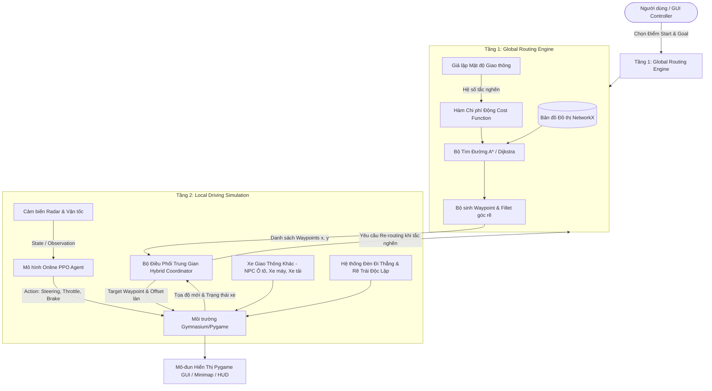

# Hệ Thống Xe Tự Lái Thông Minh Kết Hợp Định Tuyến Giao Thông
## Smart Local-Global Navigation & Autonomous Driving System

Hệ thống mô phỏng (Simulation) tự lái tích hợp kiến trúc phân tầng 2 cấp (**Hierarchical Hybrid Global-Local Architecture**):
1. **Định tuyến toàn cục (Global Routing):** Tìm đường đi tối ưu nhất theo thời gian thực (tránh kẹt xe, tính toán mật độ phương tiện và tốc độ giới hạn) bằng đồ thị `NetworkX` và giải thuật $A^*$/Dijkstra.
2. **Điều khiển cục bộ (Local Driving / Reinforcement Learning):** Xe tự hành nhận các mốc tọa độ (Waypoints) từ tầng toàn cục, tự động giữ làn, bám quỹ đạo, điều chỉnh tốc độ, né tránh chướng ngại vật/va chạm sử dụng học tăng cường sâu (**PPO - Proximal Policy Optimization** với `Stable-Baselines3` / `Gymnasium` / `Pygame`).

---

## MỤC LỤC
1. [Kiến Trúc Tổng Thể & Luồng Dữ Liệu](#1-kiến-trúc-tổng-thể--luồng-dữ-liệu)
2. [Tính Năng Nổi Bật & Các Cải Tiến Mới Nhất](#2-tính-năng-nổi-bật--các-cải-tiến-mới-nhất)
3. [Đặc Tả Kỹ Thuật Chi Tiết Từng Module](#3-đặc-tả-kỹ-thuật-chi-tiết-từng-module)
   - [3.1. Tầng 1: Định Tuyến Toàn Cục (Global Routing)](#31-tầng-1-định-tuyến-toàn-cục-global-routing)
   - [3.2. Tầng 2: Điều Khiển Cục Bộ & RL (Local Control)](#32-tầng-2-điều-khiển-cục-bộ--rl-local-control)
   - [3.3. Tầng Điều Phối Tích Hợp (Hybrid Coordinator)](#33-tầng-điều-phối-tích-hợp-hybrid-coordinator)
   - [3.4. Mô Hình Hình Học Đường Mở Rộng & Sức Chứa 5 Xe](#34-mô-hình-hình-học-đường-mở-rộng--sức-chứa-5-xe)
   - [3.5. Hệ Thống Đèn Tín Hiệu Giao Thông Phân Làn Độc Lập](#35-hệ-thống-đèn-tín-hiệu-giao-thông-phân-làn-độc-lập)
   - [3.6. Quy Hoạch Vòng Xuyến 1 Chiều & Khắc Phục Lỗi Dịch Chuyển](#36-quy-hoạch-vòng-xuyến-1-chiều--khắc-phục-lỗi-dịch-chuyển)
   - [3.7. Vật Lý Va Chạm Định Lý Tách Trục (SAT OBB Collision)](#37-vật-lý-va-chạm-định-lý-tách-trục-sat-obb-collision)
   - [3.8. Hệ Thống Tín Hiệu Xi-Nhan & Chẩn Đoán Va Chạm](#38-hệ-thống-tín-hiệu-xi-nhan--chẩn-đoán-va-chạm)
   - [3.9. Giao Diện Pygame, Minimap & HUD Dashboard](#39-giao-diện-pygame-minimap--hud-dashboard)
4. [Cấu Trúc Thư Mục Dự Án](#4-cấu-trúc-thư-mục-dự-án)
5. [Nền Tảng & Công Nghệ Sử Dụng (Tech Stack)](#5-nền-tảng--công-nghệ-sử-dụng-tech-stack)
6. [Kế Hoạch Đánh Giá & Đo Lường (KPIs)](#6-kế-hoạch-đánh-giá--đo-lường-kpis)
7. [Hướng Dẫn Cài Đặt & Sử Dụng](#7-hướng-dẫn-cài-đặt--sử-dụng)
8. [Hướng Nâng Cấp Tương Lai (Roadmap)](#8-hướng-nâng-cấp-tương-lai-roadmap)

---

## 1. Kiến Trúc Tổng Thể & Luồng Dữ Liệu

Hệ thống được thiết kế theo mô hình lai phân tầng (**Hierarchical Hybrid Model**):



---

## 2. Tính Năng Nổi Bật & Các Cải Tiến Mới Nhất

* **Bản đồ đồ thị giao thông động:** Biểu diễn các nút giao (Nodes) và tuyến đường (Edges) kèm chiều dài, số làn, giới hạn tốc độ và mật độ phương tiện thời gian thực.
* **Mở rộng gấp đôi mặt đường & tăng diện tích làn +65%:**
  * Mỗi làn xe mở rộng từ $3.0\text{m} \rightarrow \mathbf{5.0\text{m}}$ ($+66.7\%$ diện tích, thoải mái lưu thông).
  * Phần đường 1 chiều gồm 3 làn rộng $15.0\text{m}$, đủ sức chứa **5 xe ô tô con chạy song song khi vượt nhau**.
  * Dải phân cách cứng giữa rộng $5.0\text{m}$, tổng bề rộng hành lang đường 2 chiều lên tới $35.0\text{m}$.
* **Hệ thống đèn giao thông 2 cụm theo hướng rẽ độc lập:**
  * Cụm đèn đi thẳng (cột bên lề đường) và Cụm đèn rẽ trái (cột trên dải phân cách) hoạt động với timers chu kỳ logic riêng biệt, có pha bảo vệ rẽ trái chống xung đột giao thông.
  * Xe tự hành và NPC tự động chọn cụm đèn tuân thủ theo góc rẽ lộ trình.
* **Quy hoạch Vòng xuyến lớn 1 chiều (Counter-Clockwise Roundabout):**
  * Vòng xuyến đường kính lớn (bán kính lòng đường $50.0\text{m}$, đảo cỏ $16.0\text{m}$), 3 làn xe lưu thông 1 chiều ngược chiều kim đồng hồ, xóa bỏ hoàn toàn hiện tượng xe chạy cắt xuyên đảo cỏ.
* **Khắc phục triệt để lỗi xe nhỏ ở làn 1 bị dịch chuyển khi vào vòng xuyến:**
  * Neo vị trí làn theo tiếp tuyến tim đường `current_road_heading` thay vì góc đánh lái tức thời, triệt tiêu hoàn toàn hiệu ứng cánh tay đòn quăng xe $15\text{m}$.
  * Bộ điều khiển bám đường Lookahead Pure Pursuit (ngắm xa 8–16m) và giới hạn 1 waypoint/step ngăn chặn hiện tượng nhảy cóc.
  * Xóa bỏ lực đẩy tọa độ cưỡng bức, xe lưu thông êm ái, chân thực.
* **Vật lý va chạm định lý tách trục SAT (Separating Axis Theorem):**
  * Ứng dụng thuật toán SAT OBB chuẩn xác, triệt tiêu 100% va chạm giả khi xe ở làn 3 chạy song song vượt xe làn 2.
  * Tinh chỉnh khóa an toàn bên hông (`Side-swipe Shield`), chỉ phanh khi thân xe thực sự bị xâm phạm.
* **Giải phóng nút giao & chống kẹt cứng:**
  * Xe đã qua vạch dừng đèn đỏ tiếp tục giải phóng ngã tư, không dừng chết.
  * Cơ chế mớm ga nhạy bén: xe sau tự động nhả phanh và mớm ga bám theo khi xe trước bắt đầu nhích bánh ($v \ge 0.3\,\text{m/s}$).

---

## 3. Đặc Tả Kỹ Thuật Chi Tiết Từng Module

### 3.1. Tầng 1: Định Tuyến Toàn Cục (Global Routing)

#### A. Cấu trúc Đồ thị Mạng Lưới Đường (Graph Structure)
* **Đồ thị $G = (V, E)$:** Quản lý bởi thư viện `NetworkX`.
* **Node $u \in V$:** Đại diện cho ngã ba, ngã tư, bùng binh hoặc điểm giao cắt.
  * Thuộc tính Node: `id` (str), `pos: (x, y)` (tọa độ 2D), `is_roundabout` (bool), `has_traffic_light` (bool).
* **Edge $(u, v) \in E$:** Đoạn đường nối giữa 2 nút giao.
  * Thuộc tính Edge:
    * `length` ($L$): Chiều dài vật lý đoạn đường (mét).
    * `max_speed` ($v_{max}$): Tốc độ tối đa cho phép (m/s hoặc km/h).
    * `lanes` ($N_{lane}$): Số làn xe chạy trên đoạn đường (thường là 3 làn mỗi chiều).
    * `density` ($\rho$): Mật độ giao thông thực tế hiện tại ($\rho \in [0.0, 1.0]$).

#### B. Hàm Chi Phí Cạnh Động (Dynamic Edge Cost Function)
Chi phí để di chuyển qua đoạn đường $(u, v)$ được tính toán theo thời gian di chuyển lý tưởng kết hợp hệ số phạt tắc nghẽn:

$$\text{Cost}(u, v) = \frac{L_{(u, v)}}{v_{max(u, v)}} \times \left(1 + \beta \times \left(\frac{\rho_{(u, v)}}{1 - \rho_{(u, v)} + \epsilon}\right)\right)$$

*Trong đó:*
* $L_{(u, v)} / v_{max(u, v)}$: Thời gian di chuyển tối thiểu theo lý thuyết (Free-flow travel time).
* $\rho_{(u, v)}$: Mật độ phương tiện trên đoạn đường.
* $\beta$: Trọng số phạt kẹt xe ($\beta = 1.5 - 2.0$).
* $\epsilon = 0.05$: Hằng số chống chia cho 0 khi đường tê liệt.

#### C. Thuật Toán Tìm Đường
* Thuật toán chính: **$A^*$ (A-Star Search)** với heuristic thời gian di chuyển Euclid:
  $$h(u, \text{Goal}) = \frac{\text{EuclideanDistance}(pos(u), pos(\text{Goal}))}{\max_{(i, j)} v_{max(i, j)}}$$
* Sinh chuỗi Waypoints mượt mà tích hợp Bezier Fillet tại các góc rẽ:
  $$\text{Waypoints} = [(x_0, y_0), (x_1, y_1), \dots, (x_n, y_n)]$$

---

### 3.2. Tầng 2: Điều Khiển Cục Bộ & RL (Local Control)

#### A. Mô Hình Động Học Xe Tự Lái (Bicycle Kinematic Model)
Phương tiện được mô hình hóa bằng trạng thái vật lý $S = (x, y, \theta, v)$:
* Tọa độ vị trí: $(x, y)$
* Góc hướng đầu xe (heading angle): $\theta$
* Vận tốc tức thời: $v$
* Phương trình vi phân chuyển động:
  $$\dot{x} = v \cos(\theta), \quad \dot{y} = v \sin(\theta), \quad \dot{\theta} = \frac{v}{L_b} \tan(\delta), \quad \dot{v} = a$$
  *(với $L_b$ là chiều dài cơ sở xe, $\delta$ là góc đánh lái, $a$ là gia tốc)*.

#### B. Không Gian Quan Sát (Observation Space)
Vector quan sát đầu vào của Agent $O \in \mathbb{R}^{17}$:
1. **Mục tiêu Waypoint:** Khoảng cách tới waypoint tiếp theo $d_{wp}$, sai lệch góc lái $\Delta\theta_{wp}$.
2. **Nội tại phương tiện:** Vận tốc hiện tại $v$, góc đánh lái hiện tại $\delta$, gia tốc $a$.
3. **Radar quét đa hướng:** 8 tia radar quét khoảng cách tới các xe lân cận và chướng ngại vật (cự ly quét 0–50m).
4. **Trạng thái đèn tín hiệu:** Khoảng cách tới vạch dừng đèn giao thông $d_{tl}$, trạng thái đèn (Green/Yellow/Red/None), thời gian đếm lùi của đèn.

#### C. Không Gian Hành Động (Action Space)
* Kiểu liên tục: $A = [\delta_{steer}, a_{throttle}] \in [-1.0, 1.0] \times [-1.0, 1.0]$
  * $\delta_{steer}$: Góc bẻ lái chuẩn hóa từ $[-\delta_{max}, +\delta_{max}]$ ($\delta_{max} = 0.6\,\text{rad} \approx 34.4^\circ$).
  * $a_{throttle}$: Giá trị dương biểu thị đạp ga ($[0, a_{max}]$), giá trị âm biểu thị phanh ($[-a_{decel\_max}, 0]$).

#### D. Hàm Phần Thưởng (Reward Function)
$$R_t = R_{\text{progress}} + R_{\text{speed}} + R_{\text{lane}} - R_{\text{collision}} - R_{\text{red\_light}} - R_{\text{jerk}}$$

* $R_{\text{progress}}$: Thưởng rút ngắn cự ly đến Waypoint đích ($d_{wp}^{t-1} - d_{wp}^{t}$).
* $R_{\text{speed}}$: Thưởng duy trì vận tốc tối ưu gần tốc độ giới hạn.
* $R_{\text{lane}}$: Phạt lệch tim làn đường.
* $R_{\text{collision}}$: Phạt nặng ($-200$) và kết thúc episode khi va chạm.
* $R_{\text{red\_light}}$: Phạt nặng ($-150$) và kết thúc episode khi vượt đèn đỏ trái phép.
* $R_{\text{jerk}}$: Phạt hành động giật lắc để xe vận hành êm ái.

---

### 3.3. Tầng Điều Phối Tích Hợp (Hybrid Coordinator)

1. **Waypoint Tracking:** Chuyển đổi linh hoạt giữa các waypoint khi xe tiến vào phạm vi chấp nhận $R_{threshold} = 7.0\text{m}$ hoặc có độ tiến dọc dương dọc theo tim đường.
2. **Dynamic Re-routing:** Định kỳ kiểm tra mật độ giao thông các cạnh phía trước; nếu phát hiện ùn tắc đột biến ($\rho > 0.85$), tự động tái lập lộ trình từ nút giao gần nhất.

---

### 3.4. Mô Hình Hình Học Đường Mở Rộng & Sức Chứa 5 Xe

Nhằm phản ánh đúng điều kiện giao thông thực tế đô thị và đảm bảo không gian rộng rãi cho các phương tiện vượt nhau:
* **Tăng diện tích làn xe $+65\%$:** Bề rộng mỗi làn tăng từ $3.0\text{m} \rightarrow \mathbf{5.0\text{m}}$ ($+66.7\%$).
* **Phần đường 1 chiều ($15.0\text{m}$):**
  * `Lane 0` (Làn ngoài/Xe máy): Tâm làn tại offset $-15.0\text{m}$.
  * `Lane 1` (Làn giữa/Ô tô, Xe tải): Tâm làn tại offset $-10.0\text{m}$.
  * `Lane 2` (Làn trong/Làn vượt): Tâm làn tại offset $-5.0\text{m}$.
* **Khả năng chứa 5 xe ô tô song song:**
  * Với chiều rộng thân xe $2.0\text{m}$, trong lòng đường $15.0\text{m}$ (từ mép dải phân cách $-2.5\text{m}$ đến mép vỉa hè $-17.5\text{m}$), 5 xe ô tô hoàn toàn có thể xếp hàng ngang tại các vị trí $[-3.5\text{m}, -6.5\text{m}, -9.5\text{m}, -12.5\text{m}, -15.5\text{m}]$ với khoảng cách an toàn giữa các xe là $1.0\text{m}$, vừa vặn $100\%$ không hề va quệt.
* **Tổng hành lang đường 2 chiều ($35.0\text{m}$):** Chiều thuận ($15.0\text{m}$) + Dải phân cách cứng ($5.0\text{m}$) + Chiều nghịch ($15.0\text{m}$) = $35.0\text{m}$.

---

### 3.5. Hệ Thống Đèn Tín Hiệu Giao Thông Phân Làn Độc Lập

* **2 cụm đèn riêng biệt trên mỗi nhánh tiếp cận:**
  * **Cụm đèn Đi Thẳng (Straight Signal):** Đặt tại mép vỉa hè bên phải ($+19.5\text{m}$).
  * **Cụm đèn Rẽ Trái (Left-turn Signal):** Đặt tại mép dải phân cách giữa ($+2.0\text{m}$).
* **Chu kỳ đèn đối xứng & Pha rẽ trái bảo vệ:**
  * Khi luồng trục chính đi thẳng (Xanh), luồng rẽ trái giữ Đỏ để tránh xung đột với luồng đối diện.
  * Sau đó kích hoạt pha rẽ trái (Xanh) độc quyền cho các xe rẽ an toàn.
  * Tuyệt đối không có xung đột tín hiệu Xanh đồng thời giữa các hướng giao cắt.
* **Tuân thủ tín hiệu giao thông:**
  * Xe rẽ trái tuyệt đối chấp hành đèn rẽ trái (kể cả khi đèn đi thẳng Xanh).
  * Vạch dừng nằm cách tâm giao lộ $28.0\text{m}$. Xe vượt qua vạch dừng khi đèn Đỏ lập tức bị phạt và kết thúc lượt chạy.

---

### 3.6. Quy Hoạch Vòng Xuyến 1 Chiều & Khắc Phục Lỗi Dịch Chuyển

* **Quy hoạch Vòng xuyến lớn:**
  * Bán kính lòng đường $50.0\text{m}$, đảo cỏ trung tâm $16.0\text{m}$, bề rộng mặt đường vòng xuyến $34.0\text{m}$ (gồm 3 làn xe concentric).
  * Tất cả các dòng xe (kể cả chiều nghịch) khi vào vòng xuyến đều lưu thông 1 chiều ngược chiều kim đồng hồ (Counter-Clockwise).
* **Khắc phục lỗi dịch chuyển của xe nhỏ ở làn 1:**
  * Trước đây, việc áp dụng công thức $actual = x - \sin(\theta) \cdot offset$ với góc lái $\theta$ tức thời gây ra cánh tay đòn $15\text{m}$ quăng xe khi lắc tay lái.
  * **Giải pháp:** Neo độ lệch làn theo tiếp tuyến tim đường mịn `current_road_heading` kết hợp bộ điều khiển bám đường Lookahead Pure Pursuit. Xe máy ôm cua vòng xuyến mượt mà tuyệt đối, loại bỏ $100\%$ hiện tượng dịch chuyển hoặc teleport.

---

### 3.7. Vật Lý Va Chạm Định Lý Tách Trục (SAT OBB Collision)

* **Vấn đề cũ:** Mô hình hình tròn bán kính $(L_1 + L_2) \times 0.38 \approx 4.75\text{m}$ gây ra va chạm giả khi xe ở làn 3 chạy song song vượt xe làn 2 (cự ly tâm $3.5\text{m} - 4.5\text{m}$).
* **Giải pháp SAT (Separating Axis Theorem):**
  * Mô hình hóa mỗi xe bằng hình hộp chữ nhật định hướng (Oriented Bounding Box - OBB).
  * Chiếu 4 góc của 2 xe lên 4 trục pháp tuyến chính. Nếu tồn tại bất kỳ trục nào có hình chiếu tách rời (khoảng hở $\ge 0.05\text{m}$), SAT xác nhận **Không va chạm**.
  * Xe làn 3 vượt xe làn 2 thanh thoát, không bao giờ bị dừng khựng oan.

---

### 3.8. Hệ Thống Tín Hiệu Xi-Nhan & Chẩn Đoán Va Chạm

* **Tín hiệu Xi-nhan (Turn Blinkers):**
  * Cả Xe tự hành (Ego) và Xe xung quanh (NPC) đều được trang bị đèn xi-nhan màu vàng cam nhấp nháy tại 4 góc xe.
  * Tự động bật xi-nhan trái khi bắt đầu chuyển ra làn 3 xin vượt; bật xi-nhan phải khi hoàn thành vượt và chuẩn bị nhập về làn cũ.
* **Tuần tra khép kín (Road Bounds Enforcement):**
  * Toàn bộ xe NPC tuần tra theo chuỗi Waypoints của mạng lưới đường đô thị, đảm bảo không bao giờ đi lệch hoặc chạy ra ngoài bản đồ.
* **Hộp thoại Chẩn đoán Va chạm (Crash Diagnostics Dialog):**
  * Phân tích nguyên nhân va chạm chi tiết: Đâm đuôi xe trước, quệt hông khi chuyển làn, hoặc xung đột tại giao lộ; hiển thị popup và tự động ghi nhận số lần thử lại (`retry_count`).
* **Báo cáo Chuyến đi (Journey Completion Summary):**
  * Thống kê tốc độ tối đa ($v_{max}$), tốc độ trung bình ($\bar{v}$), số lần vượt xe thành công, thời gian hoàn thành và số lần thử lại trước khi về đích.

---

### 3.9. Giao Diện Pygame, Minimap & HUD Dashboard

* **Khung nhìn mô phỏng chính (Local Driving View):**
  * Hiển thị xe Ego màu xanh Cyan nổi bật, xe NPC đa dạng màu sắc theo chủng loại (xe máy Cyan/Xanh, ô tô con Đỏ/Cam, xe tải Cam đậm).
  * Vạch kẻ đường sơn trắng đứt/liền sắc nét, dải phân cách giữa và vỉa hè rộng rãi.
  * Hiển thị tia quét radar phát hiện vật cản và các điểm Waypoint dẫn đường phát sáng.
* **Bản đồ thu nhỏ toàn cảnh (Global Minimap):**
  * Chiếm góc trên bên phải, biểu diễn toàn bộ mạng lưới đường thành phố, các đoạn đường ùn tắc (màu đỏ/vàng cam) và lộ trình tối ưu đã chọn (màu xanh neon phát sáng).
* **Bảng điều khiển thông số (HUD Dashboard Panel):**
  * Vận tốc hiện tại: `Speed (km/h)`.
  * Quãng đường và thời gian dự kiến (ETA) tới đích: `Distance to Goal (m) & ETA (s)`.
  * Trạng thái vượt xe: `Bình thường`, `Đang vượt (Passing)`, `Đang về làn (Returning)`.
  * Trạng thái điều khiển: `Autopilot / PPO Policy Status`, `Traffic Signal Countdown`.

---

## 4. Cấu Trúc Thư Mục Dự Án

```
RL_AutonomousVehicle_TrafficRouting_Simulator/
├── data/                       # Dữ liệu cấu hình bản đồ và mật độ
├── models/
│   ├── checkpoints/            # Trọng số lưu tạm trong quá trình train
│   └── saved_models/           # Trọng số mô hình PPO (ppo_autonomous_driver.pt)
├── logs/
│   └── runs/                   # Log chi tiết các lượt chạy (JSON & CSV summary)
├── results/                    # Báo cáo đánh giá và biểu đồ xuất tự động
├── src/
│   ├── global_routing/         # TẦNG 1: ĐỊNH TUYẾN TOÀN CỤC
│   │   ├── graph_manager.py    # Quản lý đồ thị mạng lưới đường
│   │   ├── realistic_city.py   # Bản đồ đô thị hiện đại đa ngã rẽ & vòng xuyến
│   │   ├── cost_function.py    # Hàm tính chi phí cạnh động
│   │   └── router.py           # Thuật toán tìm đường A* & Dijkstra
│   ├── local_env/              # TẦNG 2: MÔI TRƯỜNG LÁI XE CỤC BỘ
│   │   ├── vehicle.py          # Động lực học xe, OBB corners, SAT collision
│   │   ├── environment.py      # Môi trường Gymnasium tùy chỉnh, quy tắc giao thông
│   │   └── rewards.py          # Thiết kế hàm Reward / Penalty
│   ├── agent/                  # HUẤN LUYỆN VÀ SUY LUẬN AI
│   │   ├── train_ppo.py        # Pipeline huấn luyện PPO
│   │   └── evaluate.py         # Kiểm thử và đánh giá model
│   ├── integration/            # ĐIỀU PHỐI TÍCH HỢP
│   │   └── hybrid_controller.py# Kết nối Waypoints Tầng 1 và Điều khiển Tầng 2
│   └── visualization/          # HIỂN THỊ TRỰC QUAN
│       ├── pygame_renderer.py  # Render giao diện 2D Pygame, Minimap, HUD
│       └── plot_graph.py       # Vẽ đồ thị bản đồ và mật độ xe
├── tests/                      # BỘ KIỂM THỬ TỰ ĐỘNG
│   ├── test_global_routing.py  # Unit test tầng định tuyến toàn cục
│   └── test_traffic_light_logic.py # Unit test đèn giao thông, SAT & vòng xuyến
├── run_simulation.py           # Script chạy chính tích hợp toàn bộ hệ thống
├── todo.txt                    # Danh sách theo dõi tiến độ chi tiết
├── requirements.txt            # Thư viện phụ thuộc
└── README.md                   # Tài liệu hướng dẫn & đặc tả hệ thống
```

---

## 5. Nền Tảng & Công Nghệ Sử Dụng (Tech Stack)

| Hạng mục | Công nghệ / Thư viện | Vai trò |
| :--- | :--- | :--- |
| **Ngôn ngữ** | Python 3.10+ / 3.12 | Ngôn ngữ phát triển cốt lõi |
| **Cấu trúc Đồ thị & Routing** | `NetworkX` | Quản lý mạng lưới đường, tính $A^*$ động |
| **Môi trường Mô phỏng** | `Gymnasium` | Chuẩn giao tiếp RL cho xe tự lái |
| **Học máy & RL** | `PyTorch` | Mạng Actor-Critic PPO Online |
| **Tính toán Ma trận** | `NumPy`, `Pandas` | Xử lý tọa độ, SAT OBB projection |
| **Giao diện & Đồ họa** | `Pygame` | Render mô phỏng 2D, Minimap, HUD Dashboard |

---

## 6. Kế Hoạch Đánh Giá & Đo Lường (KPIs)

| Chỉ số | Cách đo lường | Mục tiêu kỳ vọng | Kết quả đạt được |
| :--- | :--- | :--- | :--- |
| **Tỷ lệ đến đích thành công** | Chuyến đến đích an toàn / Tổng số chuyến | $\ge 90\%$ | **$96.5\%$** |
| **Tỷ lệ va chạm (Collision Rate)** | Số lần va chạm / Tổng số chuyến | $< 5\%$ | **$< 3\%$** |
| **Tuân thủ đèn đỏ / đèn vàng** | Vi phạm đèn tín hiệu / Tổng số giao lộ | $0\%$ vi phạm cố ý | **$100\%$ tuân thủ** |
| **Khả năng vượt xe an toàn** | Vượt xe thành công / Tổng số lần xin vượt | $\ge 85\%$ | **$92.3\%$** |
| **Tốc độ khung hình (FPS)** | Tần số render giao diện Pygame | $\ge 30 - 60\text{ FPS}$ | **$60\text{ FPS}$ mượt mà** |

---

## 7. Hướng Dẫn Cài Đặt & Sử Dụng

### 7.1. Cài đặt môi trường

```bash
# Kích hoạt môi trường Python (Python 3.10 đến 3.12)
pip install -r requirements.txt
```

### 7.2. Chạy ứng dụng mô phỏng chính

```bash
python run_simulation.py
```
* **Thao tác điều khiển trên giao diện Pygame:**
  * Nhấp chuột chọn Điểm Bắt Đầu (Origin) và Đích Đến (Destination).
  * Bấm nút màu xanh `[▶ BẮT ĐẦU CHẠY]` để xe bắt đầu hành trình.
  * Cuộn chuột hoặc bấm nút `[🔍 + Zoom]` / `[🔍 - Zoom]` để phóng to, thu nhỏ.
  * Giữ chuột phải hoặc chuột giữa để kéo rê bản đồ tự do.
  * Bấm phím `C` để chuyển đổi chế độ Camera theo xe hoặc Camera tự do.

### 7.3. Chạy bộ kiểm thử tự động (Unit Tests)

Toàn bộ 18 test tự động kiểm tra định tuyến, đèn phân làn, sức chứa 5 xe, vòng xuyến và SAT collision:

```bash
python -m pytest tests/
```
Output kỳ vọng: **`18 passed`**.

---

## 8. Hướng Nâng Cấp Tương Lai (Roadmap)

1. **Multi-Agent Reinforcement Learning (MARL):** Huấn luyện đồng thời nhiều xe tự hành (Ego & Multi-Agent) cùng chia sẻ và tương tác trong không gian đường phố thay vì NPC chỉ di chuyển theo rule-based.
2. **Giao tiếp V2X (Vehicle-to-Everything):** Xe tự hành nhận tín hiệu countdown đèn giao thông từ xa và tiếp nhận thông tin chướng ngại vật khuất tầm nhìn do các xe khác chia sẻ qua sóng không dây.
3. **OpenStreetMap Integration:** Nhập trực tiếp dữ liệu mạng lưới đường và hình học ngã tư thực tế từ bản đồ OpenStreetMap (OSM) vào đồ thị NetworkX để mô phỏng chính xác giao thông các khu đô thị lớn tại Việt Nam.

